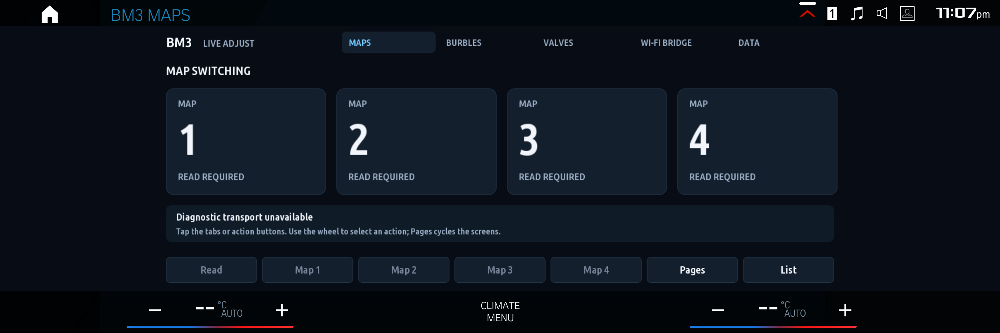

# BM3 Live Adjust for iDrive 8

Map switching, burble adjustments and vehicle data on BMW iDrive 8 with supported bootmod3 CustomROM software.



## Install through MGU Store

1. Add `danny67999/bm3-idrive8` in MGU Store's sources.
2. Select **Releases** (or the `main` branch) and install **BM3 Live Adjust**.
3. Install the dependencies the Store requests, then restart the head unit if prompted.
4. Open BM3 Live Adjust and choose **Read** to identify the ROM and read the active map.

For a private repository, first grant MGU Store read access to the repository. The GitHub `catalog` release lists the SDK-free source package. The head unit links it against its own installed BMW SDK; no BMW SDK or firmware is distributed here.

Requires iDrive 8 with MGU Store, `mgu-deploy` 0.6.9 or newer and `mgu-render` 0.6.12 or newer. This does not install or unlock CustomROM.

## Features and compatibility

- Map 1–4 selection with current-map readback.
- Burble aggression selection and explicit Apply/Off actions. Off zeros the timing table; it does not restore the flashed tune's original settings.
- Vehicle data from channels advertised by the DME.
- Native iDrive rotary navigation, graphical dashboard and native list fallback.

ROM detection selects one of 137 bundled community definitions. Unknown ROMs remain unsupported. The tests cover 269 synthetic ROM/marker scenarios; this does not establish compatibility with every BM3 vehicle. Earlier vehicle testing confirmed map and burble controls on the owner's G87; this community package still needs an independent fresh-install vehicle test.

Exhaust-valve adapters are unconfigured in this release. The Wi-Fi page can control an already installed and configured compatible bridge; automatic bridge installation and first-run network setup are not included. Ethanol display is omitted.

## Screenshots

[Maps](docs/images/bm3-maps.png) · [Burbles](docs/images/bm3-burbles.png) · [Valves](docs/images/bm3-valves.png) · [Wi-Fi](docs/images/bm3-wifi.png) · [Data](docs/images/bm3-data.png)

These are emulator captures: the actual BMW HMI framebuffer and native mgu-render output composed in the emulator's app area. The disconnected diagnostic state is real; no simulated connected status or vehicle readings were added. BMW interface artwork visible in the screenshots is separate from the app source.

## Build

Node.js 20 or newer and Python 3 on the development computer:

```sh
npm test
npm run build
npm run audit
```

`dist/bm3_live_id8@0.1.0.tgz` is the public source artifact. `dist/catalog.json` is its generated catalog. Run `python3 tools/build_store_tree.py` after changes to refresh the SDK-free branch installation tree. Compiled SDK-linked packages, BMW libraries, emulator images and vehicle captures must stay private.

## License

GPL-3.0-or-later with retained MIT and Ubuntu font notices. See [LICENSE](LICENSE) and [THIRD_PARTY_NOTICES.md](THIRD_PARTY_NOTICES.md). This project is independent of BMW and bootmod3.
