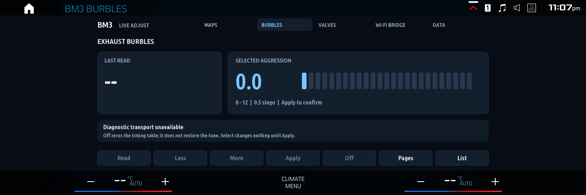
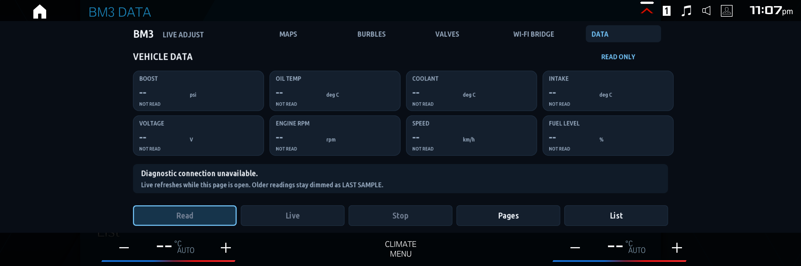

# MGU Bm3 Live Adjustments for IDrive 8

Control your bootmod3 map and burble settings directly from iDrive, and keep vehicle data on the same screen. The app installs through MGU Store and works with supported BM3 CustomROM profiles.


## Features

### Map switching

Choose between **Map 1–4** from four large map cards. Press **Read** to identify your CustomROM and read the map currently selected in the DME.

The active-map indicator follows the vehicle's reported selection, including the map retained between starts. After a switch, the app reads the selection back from the DME to update the display.

### Burble adjustments

Read the current burble settings, choose an aggression level from **0.0 to 12.0 in 0.5 steps**, then press **Apply**. Selecting a value lets you review it before applying the change.

The burble page separates the last-read setting from your selected value and recognizes custom timing tables. **Off** zeros the burble timing table; use it when you want to disable burbles rather than restore a tune preset.



### Vehicle data

Use **Read** for a sample or **Live** for recurring updates while the data page is open. The dashboard displays the channels supplied by your vehicle:

- Boost pressure
- Engine RPM and vehicle speed
- Oil, coolant and intake-air temperatures
- Control-module voltage
- Fuel level

Each tile includes its unit and sample status. Previous readings are marked as last samples when they become stale. Live polling stops when you leave the data page, and pauses when another diagnostic action needs the connection.



### iDrive controls

Navigate with the **touchscreen or rotary controller**. Focus highlighting shows which action the wheel will select, and the **Pages** button cycles through the dashboard screens. **List** opens the native BMW list interface for the same controls.

### Wi-Fi bridge controls

For vehicles with a compatible Wi-Fi bridge installed and configured, the bridge page provides **Start**, **Stop** and **Refresh**, plus the number of active diagnostic connections. It coordinates diagnostic access between Live Adjust and a phone connected through the bridge.

When using the official BM3 phone app through BMW Wi-Fi, keep the phone's Router field blank in its manual IPv4 settings to retain cellular internet access.

## Requirements

- BMW iDrive 8 with MGU Store installed.
- A BM3 tune with CustomROM and a supported ROM profile.
- `mgu-deploy` 0.6.9 or newer and `mgu-render` 0.6.12 or newer. MGU Store handles these dependencies during installation.

The app identifies the ROM automatically when you press **Read**, so you do not need to choose an engine profile or enter the car's IP address for map and burble controls. Compatibility is determined by the detected ROM, rather than the vehicle model alone.

## Install

1. Open **MGU Store → Settings → Add source**.
2. Enter `danny67999/mgu-bm3-live-adjustments-idrive-8`.
3. Choose **Releases** and install **MGU Bm3 Live Adjustments for IDrive 8**.
4. Complete any dependency updates and restart iDrive if the Store requests it.
5. Open the app and press **Read** to identify BM3 and load the current map.

The repository is public, so downloading it does not require a GitHub account or token. Store users following the `main` branch can also install the app from its source tree.

## Screenshots

[Maps](docs/images/bm3-maps.png) · [Burbles](docs/images/bm3-burbles.png) · [Vehicle data](docs/images/bm3-data.png) · [Wi-Fi bridge](docs/images/bm3-wifi.png)

Screenshots were captured in the iDrive 8 emulator.

## Support

For a connection problem or an unrecognized ROM, [open an issue](https://github.com/danny67999/mgu-bm3-live-adjustments-idrive-8/issues) with your vehicle model, model year, ROM identifier, app version and the message shown on screen. A screenshot helps reproduce display or navigation problems.

## Development

With Node.js 20 or newer and Python 3:

```sh
npm test
npm run build
npm run audit
```

See [development and release packaging](docs/DEVELOPMENT.md) for the Store build process.

## License

GPL-3.0-or-later. Third-party licenses and credits are in [THIRD_PARTY_NOTICES.md](THIRD_PARTY_NOTICES.md).
